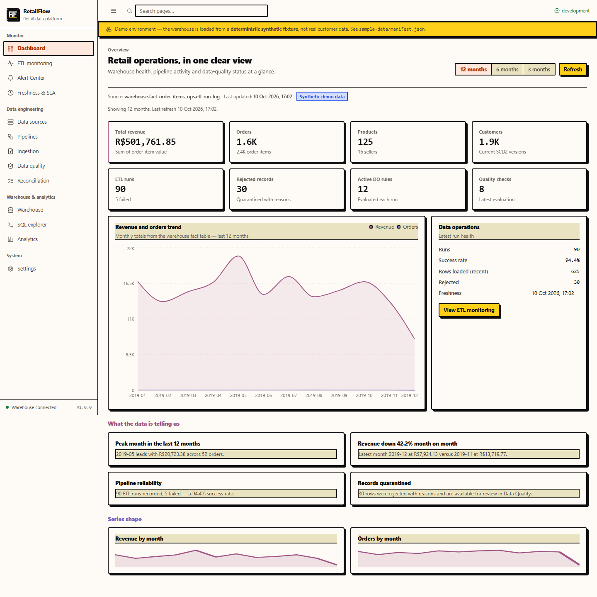
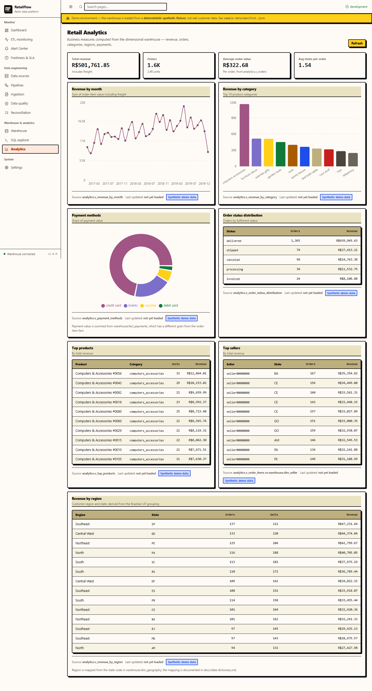
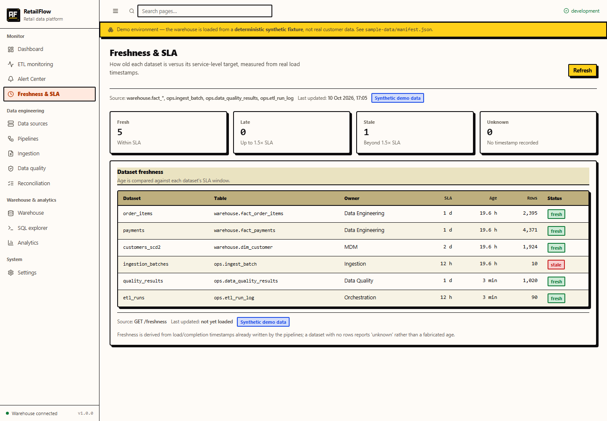
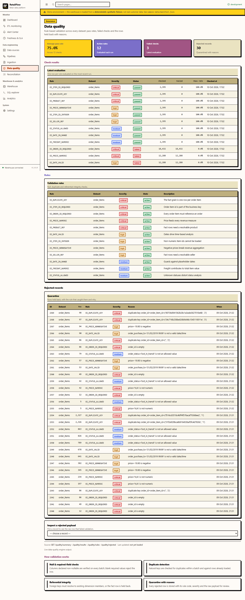
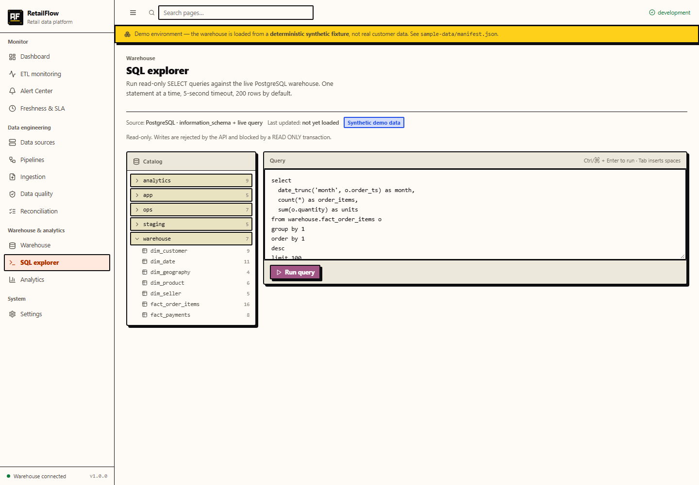

# RetailFlow

[](https://github.com/MichaelJonathan110/RetailFlow/actions/workflows/ci.yml)


**Enterprise Retail Data Warehouse, ETL Automation & Analytics Platform**

RetailFlow takes retail source files through ingestion, validation, transformation and loading into a
PostgreSQL dimensional warehouse, then serves business analytics and operational monitoring over it.
It is a complete, runnable data-engineering platform — not a mockup and not a chart gallery.

```
CSV sources → staging → data-quality rules → SCD2 dimensions + fact tables → analytics views → API → UI
```

---

## Screenshots

The UI is wired to the live API - these are real pages against the seeded warehouse, not mockups.

| | |
| --- | --- |
|  |  |
| Dashboard - KPIs, revenue trend, ETL health | Analytics - revenue by month, category, region |
|  |  |
| Alert centre - rules, severities, active alerts | Freshness & SLA - per-dataset lag and status |
|  |  |
| Data quality - rule results, pass rate, rejects | SQL explorer - read-only queries over the warehouse |

---

## 1. What actually works (verified on this machine)

| Capability | Status |
| --- | --- |
| PostgreSQL 16 warehouse in Docker, 5 schemas | **Working** |
| Star schema: 5 dimensions (SCD2 on customer) + 2 facts | **Working** |
| CSV ingestion: header normalisation, encoding/delimiter sniffing, streaming | **Working** |
| Data-quality engine with 12 seeded rules, rules-as-data | **Working** |
| Rejected-record quarantine with reasons and raw payload | **Working** |
| Idempotent ingestion (SHA-256) and idempotent loads | **Working** |
| Reconciliation with explicit tolerance and recorded variance | **Working** |
| ETL run + per-stage logging and monitoring | **Working** |
| FastAPI backend, 40+ endpoints, OpenAPI docs, error envelope | **Working** |
| Next.js UI: 10 pages wired to the real API | **Working** |
| Deterministic synthetic fixture with injected defects | **Working** |
| pytest suite incl. an end-to-end acceptance test | **Working** |
| Pentaho `.ktr`/`.kjb` artifacts | **Executed** with PDI 11 (Kitchen) against local PostgreSQL - see `pentaho/README.md` |
| Power BI semantic model + DAX + report spec | **Complete specification — no `.pbix`** (Power BI Desktop unavailable) |

---

## 2. Quick start

```bash
# 1. Configuration
cp .env.example .env          # then edit POSTGRES_PASSWORD

# 2. Database (Docker)
docker compose up -d postgres
bash scripts/init_db.sh       # schemas, tables, views, reference data

# 3. Backend
cd backend
python -m venv .venv && source .venv/Scripts/activate    # Windows git-bash
python -m pip install -r requirements.txt
uvicorn app.main:app --reload --port 8020

# 4. Demo data (new terminal, from the repo root)
python scripts/seed_demo.py --out sample-data --orders 1500
python scripts/seed_demo.py --out sample-data --orders 1500 --upload http://localhost:8020/api/v1

# 5. Load the warehouse
curl -X POST http://localhost:8020/api/v1/pipelines/6/run \
     -H 'Content-Type: application/json' -d '{"triggered_by":"quickstart"}'

# 6. UI (new terminal)
cd frontend && npm install && npm run dev
```

Or do all of it in one command:

```bash
bash scripts/run_all.sh
```

| Service | URL |
| --- | --- |
| Web UI | http://localhost:3000 |
| API docs (Swagger) | http://localhost:8020/api/v1/docs |
| API redoc | http://localhost:8020/api/v1/redoc |
| Health | http://localhost:8020/api/v1/health |

---

## 3. Repository layout

```
retailflow/
├── backend/
│   ├── app/
│   │   ├── main.py             FastAPI app, CORS, request logging
│   │   ├── config.py           settings from the environment
│   │   ├── db.py               engine, sessions, health probe
│   │   ├── errors.py           consistent error envelope
│   │   ├── routers/            health, overview, sources, ingestion, pipelines,
│   │   │                       runs, quality, warehouse, analytics, settings
│   │   └── services/
│   │       ├── ingestion.py    CSV → staging with validation and rejects
│   │       ├── rules.py        the data-quality rule engine
│   │       ├── transform.py    staging → dimensions (SCD2) → facts
│   │       ├── reconciliation.py  fact-vs-fact aggregate comparison
│   │       └── runner.py       pipeline orchestration + stage logging
│   └── tests/                  unit, API, database, end-to-end
├── database/
│   ├── ddl/                    00_schemas, 01_app, 02_ops, 03_staging, 04_warehouse
│   ├── views/                  10_analytics_views.sql
│   └── warehouse/              20_seed_reference.sql
├── frontend/                   Next.js 15 app (App Router)
│   └── src/
│       ├── app/                10 pages
│       ├── components/         shell, tables, badges, provenance, states
│       └── lib/                typed API client + formatters
├── pentaho/                    6 .ktr + master .kjb + README
├── powerbi/                    data model, DAX measures, report spec
├── scripts/                    init_db.sh, seed_demo.py, run_all.sh
├── docs/                       plan, architecture, data dictionary, lineage, testing
└── docker-compose.yml
```

---

## 4. The data model in one picture

```
                 dim_date ──┐
 dim_customer (SCD2) ───────┤
      dim_product ──────────┼──► fact_order_items   (grain: order item)
       dim_seller ──────────┤
    dim_geography ──────────┘

                            fact_payments        (grain: payment transaction)

                     analytics.v_*  →  API  →  UI / Power BI
```

The two fact tables are **never joined to each other**. They have different grains, so joining them would
multiply payment amounts by line-item count. Revenue is measured from `fact_order_items`; payments are
analysed from `fact_payments`; the two are compared as **aggregates** by the reconciliation step, and the
variance is recorded with an explicit tolerance. `analytics.v_orders` (one row per order) is the only correct
denominator for Average Order Value.

---

## 5. API surface (abridged)

| Method | Path | Purpose |
| --- | --- | --- |
| GET | `/api/v1/health` | liveness + real DB probe |
| GET | `/api/v1/overview` | KPI tiles, recent runs, latest quality, revenue trend |
| GET | `/api/v1/sources` | source registry + batch counts |
| POST | `/api/v1/ingestion/upload` | upload a CSV (multipart) → stage + validate |
| GET | `/api/v1/ingestion/batches` | batch history |
| GET | `/api/v1/pipelines` | pipeline definitions |
| POST | `/api/v1/pipelines/{id}/run` | execute a pipeline, return the run record |
| GET | `/api/v1/runs` | run history with filters |
| GET | `/api/v1/runs/{id}` | run detail with per-stage timings |
| GET | `/api/v1/monitoring/summary` | runs by status, daily counts, slowest |
| GET | `/api/v1/quality/rules` | rule catalogue |
| GET | `/api/v1/quality/results` | latest result per rule |
| GET | `/api/v1/quality/rejected` | quarantined rows with reasons |
| GET | `/api/v1/reconciliation` | reconciliation history + current totals |
| GET | `/api/v1/warehouse/tables` | warehouse catalogue with live row counts |
| GET | `/api/v1/warehouse/tables/{schema}/{table}` | columns, constraints, indexes, sample rows |
| GET | `/api/v1/warehouse/lineage` | lineage graph |
| GET | `/api/v1/analytics/*` | summary, revenue by month/category/region, top products/sellers, status, payments, customers |
| GET/PATCH | `/api/v1/settings` | settings; environment-controlled keys are read-only |

Full interactive documentation: `http://localhost:8020/api/v1/docs`.

---

## 6. Tests

```bash
cd backend && python -m pytest -v      # unit + API + database + end-to-end
cd frontend && npm test                # formatter and mapping units
cd frontend && npm run build           # production build (TypeScript must be clean)
```

The end-to-end test is the one that matters: it generates the fixture, uploads every dataset, asserts that
rejected records were produced with reasons, runs the master pipeline, asserts a second run loads **0**
additional rows, runs reconciliation, and checks that `/overview` agrees with the fact table.

See `docs/testing.md`.

---

## 7. Honest limitations

1. **No `.pbix` file.** Power BI Desktop is not available on the build machine and cannot be driven
   headlessly. The semantic model, DAX measures and report specification are complete and reproducible;
   the binary is not fabricated.
2. **Pentaho runs locally, not in the cloud demo.** The `.ktr`/`.kjb` files run with PDI 11 (Kitchen/Spoon) against the
local database and log to `ops.etl_run_log` (engine `pentaho`); the Vercel deployment has no PDI. See `pentaho/README.md`.
3. **The design reference image was not available and was not inspected.** The UI was designed from the
   written requirements with an explicit token set. No claim is made about the image's contents.
4. **No authentication.** `AUTH_ENABLED=false`. Add authn/authz before any real deployment.
5. **The SQL explorer is off by default.** Arbitrary SQL from a browser is a liability; it is opt-in.
6. **The demo data is synthetic.** Generated deterministically from seed `20240617`; it mimics the Olist
   e-commerce schema and statistics without redistributing third-party data. Every view is labelled.
7. **No browser automation in the test suite.** The frontend is covered by unit tests and a clean production
   build, not by a real browser session.

---

## 8. Roadmap to production

| Area | Next step |
| --- | --- |
| Orchestration | Replace the manual runner with Airflow/Dagster; keep the same SQL |
| Ingestion | Add S3/GCS landing, schema registry, and file-arrival triggers |
| Warehouse | Move to columnar storage (BigQuery/Redshift/Snowflake); add partitioning on `date_key` |
| Quality | Add anomaly detection and freshness SLAs, not just static rules |
| Security | SSO, RBAC, row-level security, secret manager, TLS |
| Observability | Prometheus metrics, alerting on failed runs and pass-rate drops |
| CI/CD | GitHub Actions: lint, test, build, container publish |

---

## 9. Licence and data

The code is provided as a portfolio artifact. The synthetic fixture is generated locally and contains no
real personal data. If you swap in the public Olist dataset, respect its original licence and terms.
